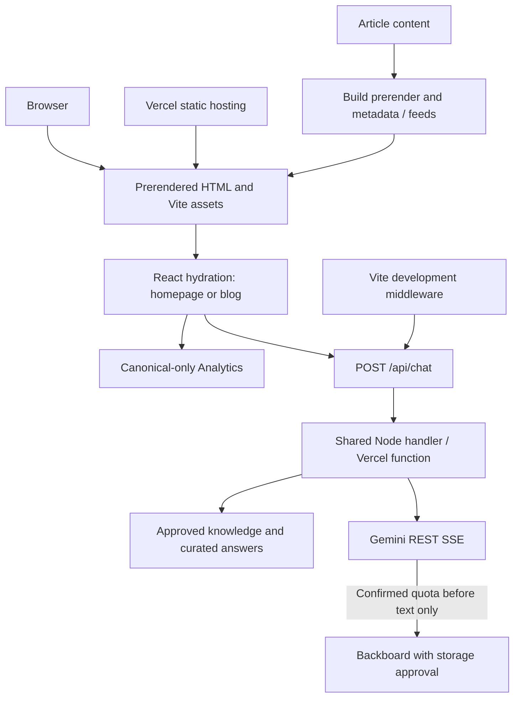

# Golixco engineering and AI-agent onboarding

Verified snapshot: **11 November 2026, Asia/Kolkata**. Source baseline: `75e56ba` on `main`. Maintained by repository maintainers; update this guide with architecture/configuration changes. This is the public entry point; it contains no private machine paths, account IDs or credentials.

## Contents

- [Current state and identity](#current-state-and-identity)
- [Windows and WSL2 setup](#windows-and-wsl2-setup)
- [First local run](#first-local-run)
- [Architecture and file map](#architecture-and-file-map)
- [Configuration and access](#configuration-and-access)
- [Chatbot and provider operations](#chatbot-and-provider-operations)
- [Vercel operations](#vercel-operations)
- [Domain and infrastructure boundaries](#domain-and-infrastructure-boundaries)
- [Homepage design](#homepage-design)
- [Blog workflow](#blog-workflow)
- [SEO and analytics](#seo-and-analytics)
- [Testing](#testing)
- [Troubleshooting and recovery](#troubleshooting-and-recovery)
- [Known limitations](#known-limitations)
- [Security and permissions](#security-and-permissions)
- [If You Are a New AI Agent, Start Here](#if-you-are-a-new-ai-agent-start-here)
- [Maintenance and deeper references](#maintenance-and-deeper-references)

## Current state and identity

Golixco builds useful software and products through AI, creativity and experimentation. Its public identity is minimalist black and white, pixel inspired, with the official G emblem and controlled motion. The name originated in 2020; this is not evidence of a legal founding date. Leadership identities and unpublished business metrics remain private. Do not infer incorporation, funding, biographies or future releases.

The company site is live at [golixco.com](https://golixco.com). [Lolixco](https://lol.golixco.com/) is its separate live public-beta product for cinematic edit discovery and experimental Creator Studio analysis. This repository describes that product and links to it; it is **not the full Lolixco application**. Approved product routes, contacts and social destinations come from [shared/official.ts](shared/official.ts), used by both UI and assistant. Do not replace these with guessed destinations or personal accounts.

Public documents are `/`, `/blog`, `/blog/the-golixco-blog` and `/blog/the-lol-product-lolixco`. The repository lives at [Golixco/Golixco_HomeUI](https://github.com/Golixco/Golixco_HomeUI). Compare the deployed commit with `origin/main` and run the production smoke test after a release. The [Vercel operations](#vercel-operations) section documents the release workflow.

Evidence labels used here: **repository** means inspected source; **runtime** means fresh read-only service inspection; **historical** means earlier recorded verification; **unknown** requires owner evidence. No new provider generation, deployment, credential change or DNS change was performed for this documentation task.

## Windows and WSL2 setup

The inspected development environment is Ubuntu 24.04.3 LTS on a Microsoft WSL2 kernel, with Node 24.22.1 and npm 11.19.1. The checkout is in the Linux filesystem, separate from Windows attachments and the Lolixco application. Machine-specific paths, identities and Windows edition/build belong only in the private owner handbook. Windows 11 is the intended fresh-machine target; check the installed edition rather than assuming it from WSL alone.

From an administrator PowerShell window on a supported Windows installation:

```powershell
wsl --install -d Ubuntu
wsl --update
wsl --status
wsl --list --verbose
```

Restart when requested, open Ubuntu from Windows Terminal/Start, and create a Linux user/password. The distribution must show version 2. If an existing distribution uses version 1, review backups and prerequisites before `wsl --set-version Ubuntu 2`. Firmware virtualization and Windows Virtual Machine Platform may need enabling; older Windows builds need Microsoft's manual procedure. See [Microsoft installation guidance](https://learn.microsoft.com/en-us/windows/wsl/install). If installation stalls, consult its web-download option rather than repeatedly reinstalling.

In Ubuntu, install basic tools (these commands modify only the development machine):

```bash
sudo apt update
sudo apt install git curl ca-certificates build-essential
```

Use an editor's WSL integration, such as VS Code Remote WSL, so Node and Git execute inside Linux. Keep active repositories under the Linux home directory for filesystem performance and permissions. Windows disks appear under `/mnt`; access Linux files through Explorer's WSL integration. Avoid sharing one `node_modules` directory between Windows and Linux.

Install nvm using the reviewed installer from [nvm's official instructions](https://github.com/nvm-sh/nvm#installing-and-updating); inspect the current release command before executing it. Reopen the shell or source its nvm initialization. Then:

```bash
mkdir -p ~/projects
cd ~/projects
git clone https://github.com/Golixco/Golixco_HomeUI.git
cd Golixco_HomeUI
nvm install
nvm use
node --version
npm --version
npm ci
```

`.nvmrc` selects Node 24 and `package.json` requires 24.x. Use npm with `package-lock.json`; avoid alternate lockfiles or accidental upgrades. Do not use sudo for npm installs under nvm. Install Vercel CLI with `npm install -g vercel` only when needed; verify its version/help. GitHub CLI is optional for PR operations.

Configure Git with your own approved public commit identity, never someone else's local identity:

```bash
git config user.name 'YOUR_APPROVED_PUBLIC_NAME'
git config user.email 'YOUR_APPROVED_PUBLIC_EMAIL'
git fetch origin
```

HTTPS can use GitHub CLI login or a credential manager. SSH requires an owner-approved GitHub account, a locally generated key and only its **public** key registered with GitHub. Verify host fingerprints against official GitHub documentation. Never copy a private key or token into this guide, shell arguments or Git remote URLs. Public cloning needs no write token; pushing needs scoped repository write permission. `gh auth login` and `gh auth setup-git` are supported onboarding choices; do not print auth tokens.

## First local run

From the repository root:

```bash
nvm use
npm ci
# Create only if absent; never overwrite the owner's private configuration.
if [ ! -e .env.local ]; then cp .env.example .env.local; fi
chmod 600 .env.local
npm run dev
```

Open `http://localhost:3000/` from Windows. Vite binds `0.0.0.0:3000` with strictPort; this binding is not an invitation to expose it publicly. Curated questions work without API credentials. The Vite plugin in [vite.config.ts](vite.config.ts) loads server configuration, mounts the real Node handler at `/api/chat`, renders documents and serves generated feeds. It denies direct server/API source requests. This is not a mocked backend.

Stop with Ctrl+C. Restart after environment changes; existing process variables can override loaded file values. `npm run build` produces production assets and prerendered HTML. `npm run preview` serves built frontend assets only; it does **not** mount the development chat middleware or create a Vercel function.

First-run checklist:

1. Confirm Node 24 and successful `npm ci`.
2. Check port 3000 with `ss -ltnp`; stop only an identified process you own.
3. Open homepage and all three blog routes, including direct refresh.
4. Ask the synthetic public question “What is Golixco?”; expect knowledge SSE and completion.
5. Check a nonexistent route returns 404 and browser console has no hydration errors.
6. Add model credentials only through the owner's approved mechanism; no credential is required merely to read articles.

If Windows localhost fails, try the same URL with curl inside WSL, check Windows firewall/VPN and WSL networking settings, and ensure Vite started on the intended port. Do not disable the firewall globally. Changing the development port also requires reviewing the API's local-origin allowlist. After a WSL networking restart, restart the server. Avoid `wsl --unregister`, which destroys the distribution.

## Architecture and file map

React 19/TypeScript provides shared component rendering, Vite handles development and asset compilation, Tailwind 4 styles the interface, Motion handles animation, and React Markdown displays constrained provider text. There is no CMS, database, user authentication or always-running production Node web server. Preserve the architecture unless an approved task justifies a change.



| Change area | Source and responsibility |
| --- | --- |
| Page composition | [src/App.tsx](src/App.tsx) composes homepage sections; [src/main.tsx](src/main.tsx) loads the correct app and hydrates existing HTML, otherwise creates a root |
| Server rendering | [src/entry-server.tsx](src/entry-server.tsx) renders the same React components for Vite and prerender builds |
| Navigation/footer | [src/components/Navbar.tsx](src/components/Navbar.tsx), [src/components/Footer.tsx](src/components/Footer.tsx); shared approved destinations |
| Chat UI | [src/components/HeroSection.tsx](src/components/HeroSection.tsx): input, messages, SSE parser, stop/reset and constrained Markdown |
| Branding/motion | [src/components/BrandName.tsx](src/components/BrandName.tsx), [src/index.css](src/index.css), `public/brand/`, `public/fonts/` |
| Other homepage sections | `AboutSection`, `HistoryTimeline`, `InfiniteSocialConveyor`, `NewsletterSection`, `ScrollReveal` under `src/components/` |
| API boundary | [api/chat.ts](api/chat.ts) exports [server/chat.ts](server/chat.ts)'s shared handler |
| Company facts | [api/knowledge.json](api/knowledge.json) statically imported by [server/knowledge.ts](server/knowledge.ts); curated matching and model system instructions |
| Model transports | [server/gemini.ts](server/gemini.ts), [server/providers.ts](server/providers.ts), [server/backboard-catalog.ts](server/backboard-catalog.ts) |
| Blog | [src/blog/articles.ts](src/blog/articles.ts) content, [src/blog/BlogApp.tsx](src/blog/BlogApp.tsx) layout, [src/blog/SummaryWidget.tsx](src/blog/SummaryWidget.tsx) external summary tools |
| SEO/build | [scripts/page-document.ts](scripts/page-document.ts), [scripts/prerender.ts](scripts/prerender.ts), [scripts/feeds.ts](scripts/feeds.ts), [index.html](index.html) |
| Hosting | [vercel.json](vercel.json), `.vercelignore`, `.gitignore`, [tsconfig.json](tsconfig.json) |
| Monitoring/tests | [src/analytics.ts](src/analytics.ts), `tests/`, both Playwright configurations, `scripts/check-vercel-function.mjs` |

Vite compilation runs before prerender. The prerender script temporarily bundles the server renderer with esbuild, writes each canonical route's directory `index.html`, injects its unique head, writes feeds and removes `.prerender/`. Render-blocking CSS in the document head prevents reliance on JavaScript styling at first paint. `rewriteRelativeImportExtensions` ensures Vercel's emitted JS imports compiled `.js` files rather than missing `.ts` files. Keep knowledge statically imported: runtime cwd/file reads can fail in serverless packaging.

## Configuration and access

`.env.local` is ignored, private and server-side. It is not automatically transferred to Vercel. Set hosted variables in the intended Vercel environment through owner-authorized access; changes require an appropriate new deployment. Never prefix secrets with `VITE_`, which exposes them to client builds. Do not use `env`, `printenv`, `cat .env.local`, token-printing commands or environment dumps for onboarding. Verify names and non-value presence through approved interfaces.

| Name | Requirement / issuer | Reader and effect | Failure / activation |
| --- | --- | --- | --- |
| `GEMINI_API_KEY` | Required for external inference; Google AI Studio owner project | `server/chat.ts`, `server/gemini.ts`; runtime, server only | Missing key leaves curated answers available; model request returns safe 503. Invalid key can produce access errors |
| `GEMINI_MODEL` | Optional model override; Google model catalog | `server/gemini.ts`; runtime default `gemini-3.5-flash-lite` | Unsupported/inaccessible model fails safely; verify owner account access |
| `BACKBOARD_API_KEY` | Optional fallback credential; Backboard account | `server/providers.ts`; runtime authenticated catalog and generation | Missing key disables fallback |
| `BACKBOARD_LLM_PROVIDER` | Required with fallback; exact catalog provider | Provider/catalog adapter; runtime | Example `openrouter`; absent disables fallback |
| `BACKBOARD_MODEL` | Required with fallback; exact authenticated catalog name | Adapter; runtime | Example `google/gemma-3-27b-it`; missing disables or unmatched model fails closed |
| `BACKBOARD_STORAGE_APPROVED` | Owner privacy decision, not a provider-issued credential | Adapter runtime gate, literal `true` required | Safe example `false`; do not enable merely because a key exists |
| `GOLIXCO_CHECK_PROVIDERS` | Optional build-only diagnostic flag, default absent | `scripts/provider-preflight.mjs` before Vite | `1` makes authenticated read-only model/catalog checks; no generation or configuration mutation |

The first six names are loaded from local files into the backend by Vite, and configured separately in Vercel Production/Preview/Development as needed. Build preflight uses the build environment; plain Node scripts do not inherit Vite's loader automatically. Vercel supplies platform variables such as `VERCEL_URL`; do not fabricate or publish platform tokens. Historical local storage approval does not authorize hosted approval.

| Task | Minimum access |
| --- | --- |
| Read source, run static UI/unit tests | Public repository read; local tools |
| Push branch/open PR | Scoped repository write; no cloud admin |
| Inspect hosting/logs | Existing Vercel project read/log permission |
| Model-backed local development | Owner-provisioned Gemini key with restricted project access |
| Fallback test | Backboard credential, approved model, credits and explicit storage/generation approval |
| DNS/mail administration | Separately approved Cloudflare/registrar access; unnecessary for UI changes |
| Index status/submission | Owner-granted Search Console property access |

Obtain Google credentials through the owner's AI Studio project, Backboard credentials through its account, and Vercel/GitHub access through invitations or approved login. Owner maintains password-manager entries and MFA/recovery methods outside this public repo. Rotation means creating/restricting a replacement in the issuing service, updating only authorized local/hosted scopes, validating an approved release and revoking the old credential. Do not rotate anything merely because you are onboarding.

## Chatbot and provider operations

Authority is approved public knowledge plus exact official links. Launch catalog facts are historical (57 edits: 27 YouTube-hosted, 30 hosted), not a live metric. Six analysis dimensions, beta/accuracy limitations and leadership privacy are enforced in curated answers and system instructions. History is untrusted; do not invent facts or retrieve private files.

Flow: validation and application limits → curated answer if available → Gemini → **confirmed quota/rate-limit failure before any text** → configured, approved Backboard. Quota opens a 60-second per-instance cooldown. Ordinary 400/401/403/5xx errors, timeouts and partial output do not trigger fallback. Every model attempt, including fallback, consumes the shared instance budget. No automatic provider retry is implemented.

Gemini uses native fetch against Google's REST SSE endpoint, minimal thinking and 2048 maximum output tokens. It carries role-mapped history and the authoritative system instruction, rejects incomplete/non-STOP responses, forwards text rather than thought parts, retains structured HTTP/in-stream quota codes, and propagates cancellation. Handler timeout is 30 seconds; provider response and delivered output are bounded. Cancellation cannot guarantee the provider stops billing already-started work.

Backboard has no default provider/model. Authenticated provider-filtered catalog lookup paginates with a safety ceiling and requires exact model matching, LLM type, at least 8192 context, finite nonnegative prices at most $0.50/M input and $1/M output, and no explicit streaming denial. Historical verification found Gemma 3 27B at $0.08/$0.35 per million and 131072 context with streaming advertised; these are **dated evidence, not current quotes**. Recheck the account catalog before approving use. Never silently select a more expensive substitute.

The adapter sends only four recent untrusted turns, the question and approved system instruction. Memory, web search and media generation are off; tools are empty. It creates one-use thread/assistant state, cancels a known unfinished run, and attempts thread/assistant deletion with independent short deadlines. Cleanup failures fail the response. Missing IDs, termination, transport failure, provider logs/backups or upstream retention can leave state: memory off and deletion do not guarantee zero storage. `BACKBOARD_STORAGE_APPROVED=true` is a privacy-sensitive owner decision.

### HTTP and SSE contract

`POST /api/chat`, `Content-Type: application/json`:

```json
{"message":"What is Golixco?","history":[{"role":"user","text":"Explain Lolixco"}]}
```

History roles are `user`/`bot`. Bounds: 20000 body bytes, 1200 question characters, 12 history messages, 2500 characters per history item and 12000 combined context characters. Per instance: 12 requests/minute and 120/hour per hashed client identity, 2000 identities, four active external requests and 200 provider attempts per UTC day. These are ephemeral instance safeguards, **not global spend caps**.

Successful transport uses `text/event-stream` frames separated by blank lines:

```text
data: {"type":"start","source":"knowledge"}

data: {"type":"delta","text":"Approved company information"}

data: {"type":"done"}

```

Model starts use source `gemini`. The handler sends a complete reply in one delta after the provider finishes, then sends `done`. The `backboard_complete` log category records a successful fallback. Errors before streaming use JSON/status codes; after headers, an SSE `error` event can occur even with HTTP 200. Heartbeats are comments. The frontend keeps errors with the question and lets the user retry the latest failed reply. Safe request IDs/categories support correlation without logging message text. Hosted origins include canonical sites and the exact deployment hostname; local allowed ports are defined in `server/chat.ts`. Origin validation is not authentication, and non-browser clients can call the endpoint. Configure shared edge protections and provider-side caps separately with owner approval.

### Debugging decision tree

First identify the deployed revision and HTTP/SSE outcome, using a synthetic public question only. Curated failure suggests routing/packaging/validation rather than model quota. Curated success plus model failure narrows investigation to configuration/provider/stream handling. Read safe categories before making another paid request.

- 405/415/400/413: inspect method, content type, payload/history sizes; fix caller first.
- 403: check Origin/Sec-Fetch-Site and exact Preview hostname; do not weaken to wildcard.
- 429: distinguish application limit/daily attempt budget from confirmed provider quota; wait for the correct window, inspect account usage privately. Never exhaust quota intentionally to test fallback.
- 503: confirm presence of the server-side Gemini key in the correct scope; do not print it.
- Provider access/model error: verify issuer, restrictions and selected model; a read-only model GET does not prove generation quota or quality.
- Backboard unavailable: inspect literal approval gate, credential presence, catalog exact name, cost/context/streaming checks and cleanup status. Do not bypass a failed gate.
- Empty/non-STOP stream: retain safe finish/packet indicators and request ID. Do not declare it quota without structured evidence or fake a successful answer.
- Timeout/cancellation: inspect client disconnect and abort propagation; preserve the deadline and avoid mixing providers after text.
- Function 500 before start: inspect compiled imports, deployment/build logs and actual artifact.
- Network/SSE works but UI fails: inspect browser console and `HeroSection` parser, event delimiters, state and CSP. Never paste visitor transcripts into diagnostics.

## Vercel operations

Production already exists. Never create a duplicate project or assume authentication grants deployment authority. Ask owner for the existing project/team selection; private locators stay outside public docs.

Repository configuration: Vite preset, root `.`, `npm ci`, `npm run build`, output `dist`; Node 24.x selected by package engines, `api/chat.ts` maximum 45 seconds. Read-only project inspection reported a dashboard Node 26.x default: the package override and actual compiled function runtime must be checked together. Do not silently change either. CSP permits same-origin scripts/connections, denies embedding and objects, limits forms/base URL and upgrades insecure requests. API responses are no-store; hashed assets cache immutable for one year. Clean URLs and no trailing slash use prerendered files plus branded 404; there is no blanket SPA rewrite.

CLI 65.14.0 was inspected. Always check installed help if syntax/version differs:

```bash
vercel --version
vercel whoami
vercel project ls
vercel project inspect PROJECT_NAME
vercel env ls production
vercel inspect https://golixco.com --json
vercel inspect DEPLOYMENT_URL --logs
vercel logs runtime --environment production --since 10m --limit 20 --json
```

`env ls` lists names/scopes, not values. Runtime log streams may contain sensitive legacy output; inspect privately and report only approved categories/request IDs. Retention depends on plan; shorten the time window if unavailable. No production logs is not proof of no errors. Project Settings → Environment Variables, Deployments → build/runtime logs, Analytics and Firewall are separate interfaces. Provider usage belongs in Google/Backboard dashboards, not Analytics.

`vercel login` changes local authentication. `vercel link --project PROJECT_NAME --scope APPROVED_SCOPE` changes local project linkage; confirm the existing target before accepting prompts. `.vercel/` is ignored. Do not use secret export commands to populate documentation. Project defaults may be overridden by checked-in `vercel.json`; inspect resolved build output before drawing conclusions.

The Vercel GitHub integration creates Previews for pushes to repository branches and deploys pushes and merges to `main` to Production. The Vercel status on the GitHub commit and the deployment's commit SHA identify which revision was built. Vercel requires authorization for fork Previews.

1. Branch from current `main`, run relevant checks, then push and open a PR. Use an author email GitHub associates with the `Golixco` account. Check attribution before committing with `git config --get user.name` and `git config --get user.email`. Keep private email addresses out of PRs.
2. Verify the branch deployment with `vercel list --environment preview --meta githubCommitSha="$(git rev-parse HEAD)"`. If the Git deployment was skipped or is missing, run `npx vercel deploy --yes` from the clean branch checkout in the linked project. Include the ready Preview URL in the PR summary. Keep Preview protection enabled.
3. After a merge or direct push to `main`, verify the Vercel status on that commit and use `vercel inspect https://golixco.com` to confirm the live deployment. Compare its Git SHA with `origin/main`. If Git did not start a build, update a clean checkout to the latest `origin/main` and immediately run `npx vercel deploy --prod --yes` from that checkout. Check the existing Git deployment first to avoid racing two Production releases.
4. After `golixco.com` points to the new deployment, run `npm run smoke:production`. It checks the canonical chat endpoint for HTTP 200 and a complete greeting stream without using model quota.

Rollback is production-changing and needs explicit owner approval. Confirm a genuinely known-good deployment and configuration, then use `vercel rollback DEPLOYMENT_URL` per [current rollback documentation](https://vercel.com/docs/cli/rollback). Inspect the result and public behavior; never choose “previous” blindly. Rollback eligibility and promotion behavior depend on project/plan. Capture status and recovery references without secrets. Shared Firewall rules, billing/plan eligibility and spend limits require owner verification; instance rate limits do not replace them.

## Domain and infrastructure boundaries

The canonical company hostname is served through Vercel; public HTTPS is accessible. Account-level Cloudflare zone records, registrar, Email Routing settings, AWS resources and certificate ownership were not authenticated for this guide. Do not turn historical deployment notes into a verified zone inventory.

An A/AAAA record maps a hostname to IPv4/IPv6; CNAME aliases another hostname. MX controls incoming mail. TXT can carry service verification, SPF sender authorization, DKIM public keys and DMARC policy; these are distinct from website routing. TLS secures HTTPS and may terminate at an edge proxy before the origin. Cloudflare proxied versus DNS-only mode changes traffic handling/caching and certificate expectations; public DNS alone cannot prove private origin/proxy settings.

Homepage releases must preserve `lol.golixco.com`, any separate AWS/CloudFront/ACM infrastructure, mail MX/SPF/DKIM/DMARC records and unrelated verification records. Protect Cloudflare Email Routing even when changing website hosting. A public DNS answer proves resolution, not ownership, routing-policy correctness or email delivery. For incidents, first inspect Vercel deployment/domain/TLS state, then compare authorized DNS inventory with registrar delegation; ask owner for account access rather than guessing records. No DNS/email changes are part of normal frontend deployment.

## Homepage design

`Navbar` uses the official G emblem, Products / Blog / Contact / Follow navigation, accessible dropdowns/mobile menu, Escape/outside dismissal and visible focus. Lolixco receives a dark warm amber-gold hover/focus treatment. Contacts route to company/support/rights through shared links. Footer keeps a dimmed emblem without a wordmark.

`HeroSection` keeps the main prompt on one desktop line and wraps on mobile, with intentional empty space where earlier tagline/deck text was removed and a subdued AI caveat. `BrandName` starts Japanese → simplified Chinese → English, then rotates other scripts; non-English dwell is two seconds and English three. These are phonetic branding renderings, not official translations. Local font subsets carry licenses; decorative animation hides while focusing/typing and reduces to static English for reduced motion.

About, name-history timeline, scroll-driven social conveyor and full accessible social list preserve the visual system. Reduced-motion behavior, keyboard navigation, skip link, contrast, mobile menu scrolling and chat scroll boundaries matter when editing. Newsletter signup is an honest coming-soon state: there is no subscription storage, database, consent workflow or sending service. Do not imply a submission succeeded. Preserve supplied brand geometry and asset/font/icon licenses.

## Blog workflow

The shared typed article model contains slug, category, title, description, cover/alt, modified/published dates and sections (`id`, `title`, Markdown body). `BlogApp` provides cards, article header, reading time (220 words/minute), cover, desktop sticky TOC, mobile disclosure TOC, active-section tracking, breadcrumbs and related navigation. Stable section fragments support direct links, history/back/forward and fixed-header offsets. Published dates in source record the initial public release calendar date; do not substitute a build date for content publication.

To add a third article:

1. Add an `Article` record to `src/blog/articles.ts` with a unique lowercase hyphenated slug, factual title/description and original approved text. Never link private personal identity to the company using reference artwork or screenshots.
2. Give sections unique stable IDs; preserve published IDs when editing and review inbound fragments before renaming.
3. Supply a licensed/approved cover and meaningful alt text in `public/blog/`; provide `public/blog/SLUG-social.png` at 1200×630 because the metadata helper derives that path.
4. Set genuine modification/publication dates. Keep unpublished dates absent rather than fabricated. Check the article header handles optional publication.
5. `publicPaths` derives article routes. Build output, cards, related links, reading time, canonical metadata, JSON-LD, RSS and sitemap derive from that model. Inspect all generated outputs; fixed dates or assumptions in `scripts/feeds.ts` may need updating.
6. Add the new route to the explicit analytics path allowlist in `src/analytics.ts` and extend appropriate tests. Check RSS publication date, social image response, direct route, fragment, mobile TOC and unknown-route behavior.
7. Run focused metadata/browser tests and production build; inspect initial HTML without JavaScript before PR review.

`SummaryWidget` constructs a factual/opinion-aware prompt using the exact public canonical URL, never localhost/Preview, fragments or sensitive query values. Grok's HTTPS query prefill was historically observed in a review-before-send dialog; Google opens a prepared query with fallback; ChatGPT/Claude use copy/open/paste. Clipboard failure exposes a selectable prompt, native anchors preserve the click gesture and external links use noopener/noreferrer. No widget calls Golixco's paid APIs. Login, fetching, deep links and installed mobile app routing are destination/OS-controlled; HTTP 200 alone does not verify prefill and no universal automatic submission is promised.

## SEO and analytics

`page-document.ts` owns unique titles/descriptions, canonical URLs, Open Graph/Twitter metadata and JSON-LD Organization, WebSite, Blog, BlogPosting and BreadcrumbList. Initial HTML contains the actual article, not an empty SPA shell. Homepage/blog index use `public/og-image.png` (1672×941); articles retain distinct 1200×630 previews. `index.html` supplies matching base metadata and immediate stylesheet loading. Do not remove prerendering, hide the document for JavaScript or stretch supplied social imagery to mask a rendering issue.

`public/robots.txt` references the production sitemap. `scripts/feeds.ts` generates build-time `sitemap.xml` and `rss.xml`; development middleware serves generated versions. Public placeholder feed files are copied before build generation, so inspect **dist** and live responses rather than assuming the public copies are final. `public/llms.txt` holds approved AI-readable company/product facts; do not create a duplicate `llm.txt` or treat it as a Google-indexing mechanism.

For each public route, inspect HTTP 200, a single canonical, unique title/description, robots directives, heading hierarchy, image alt/dimensions, structured data, correct absolute OG/Twitter image URL, prerendered text, hydration and direct refresh. Check all resources and fragments, 404 for an invented route, sitemap entries without fragments, RSS dates and robots crawlability. Test desktop/mobile under throttling; a fast local server can hide CSS-loading errors. Recheck public image type/access after deployment; protected Previews cannot prove crawler access. LinkedIn Post Inspector and X's available card tools can help inspect caches after release; do not claim cache invalidation without evidence.

Indexable means technically eligible; submitted means a sitemap or request was sent; crawled means Google fetched it; indexed requires actual URL Inspection evidence. Search Console access/index status was not verified for this handoff. Owner should select/verify the appropriate property, submit `https://golixco.com/sitemap.xml`, use Test live URL and request indexing once if appropriate for each canonical. Verification TXT changes require DNS authorization. Google decides inclusion, ranking and displayed snippets; there is no instant-indexing guarantee.

`src/main.tsx` calls `startAnalytics()` once outside StrictMode before hydration. Official `@vercel/analytics` injects only for production builds on canonical origins, permits only four public page paths, removes query/hash and rejects custom events. Ordinary full document links and SDK history tracking avoid additional manual pageview calls. Strict-origin referrer policy limits outgoing referring URLs; CSP permits same-origin insights resources. No chat text or keys are event properties. Preview/local visits do not enter the live dashboard.

Verify production collection only after the matching release: visit approved public pages without a blocker, inspect successful same-origin `/_vercel/insights/script.js` and `/view` requests, then check Vercel Web Analytics date/path filters. Dashboard enablement is not proof of received traffic. Function logs diagnose requests, build logs diagnose compilation, Analytics measures visits and provider dashboards measure inference/quota/cost. These are different evidence sources. Confirm the deployed commit before checking collection.

## Testing

Documentation changes need link/configuration/sensitive-diff checks, not expensive generation or the whole test suite. For code changes choose checks that exercise the affected behavior. Do not cite historical test counts as fresh results.

| Command | What it checks / prerequisites |
| --- | --- |
| `npm run typecheck` | TypeScript noEmit; installed dependencies/Node 24 |
| `npm test` | Node tests via tsx: approved facts, payload/origin/rate limits, streaming/cancellation, safe links/diagnostics, provider mocks, metadata and bundles; no real-provider proof |
| `npm run build` | Vite assets plus esbuild/React prerender, SEO and feeds; provider preflight inert unless explicitly enabled |
| `npx playwright install chromium` | Installs browser into local cache; Linux may additionally require Playwright's documented OS dependencies/admin approval |
| `npm run test:ui` | Default Playwright configuration starts/reuses dev port 3000; tests UI, mobile, animations, hash navigation and synthetic streaming |
| `npx playwright test --config playwright.production.config.ts` | Build first; production frontend preview on port 4173; first paint/refresh, throttled mobile, telemetry-intercepted privacy and summary fallback |
| `vercel build --target=preview` then `npm run test:vercel` | Actual platform-emitted Node JS imports and curated SSE outside source cwd; requires correct local project linkage/platform build tooling |
| `npm audit` | Current advisory report; network-dependent, not a source change or proof all issues are fixed; avoid automatic `audit fix --force` |

Test healthy known-company answers, unrelated/injection refusal, private leadership refusal, malformed/oversized payloads, nonquota failure with no fallback, confirmed quota before text with one fallback, partial output with no provider mixing, stop/reset, timeout and no secret/error-body leakage. Add metadata and route coverage when adding articles. Production browser tests intercept analytics and do not inject fake production events.

Before an authorized PR push, check `git diff --check`, diff contents, staged file names and absence of secrets/private paths. Inspect `.gitignore` and `.vercelignore`; never serialize environment/authentication stores into artifacts. Real-model smoke tests are separate, explicitly authorized, small synthetic public requests; they may cost money. Backboard smoke requires separate storage approval and includes deletion verification. `scripts/backboard-catalog.mjs` is read-only but loads local env privately; `scripts/backboard-smoke.mjs --confirm` is **not** an ordinary unit test. Never run it implicitly or induce quota exhaustion.

## Troubleshooting and recovery

| Symptom | Safe diagnosis and recovery | Escalate when |
| --- | --- | --- |
| WSL fails to start | Check PowerShell WSL status/version, Windows virtualization/features, official install guidance; restart only after saving work | Admin/firmware access required; never unregister to guess |
| Git authentication fails | Check remote host and approved account access, credential manager/SSH agent; reauthenticate through official login | Account/MFA recovery needed; never print tokens |
| Node mismatch / npm ci fails | `nvm use`, compare package engines/lockfile, inspect install error/platform; do not casually regenerate lock or run sudo npm | Lock genuinely inconsistent or dependency policy blocks installs |
| Port occupied / Windows localhost fails | `ss -ltnp`, identify owner process, check bind/strict port, compare WSL curl with Windows access, review VPN/firewall | Network/admin changes required |
| Dev API fails | Confirm `npm run dev`, exact `/api/chat`, local origin and server-only key presence; static preview has no API | Provider access or deployment issue |
| Quota / rate limit | Distinguish application budget vs provider structured 429; inspect private usage; wait or seek owner-approved quota decision | Paid quota/storage/model change needed |
| Backboard model rejected | Authenticated exact-name catalog, price/context/streaming eligibility, approval and cleanup logs | No eligible model or privacy approval absent |
| Hosted variables missing | Check names/scopes and deployment timestamp without values; local env does not populate Vercel | Owner must provision scopes and approve release |
| Build or function 500 | Inspect build/runtime categories and emitted imports, Node/package settings, bundled JSON; test actual artifact | Cloud access or new deployment required |
| Blog 404 / missing OG | Verify typed slug, derived publicPaths, build directory and matching social filename/type; distinguish protected Preview from public failure | Hosting/domain configuration differs |
| Unstyled flash / hydration failure | Inspect initial stylesheet links and paths, render-blocking order, SSR/client component parity and console, test slow network/JS disabled | Do not hide content or remove SEO to mask issue |
| Analytics absent | Check deployed SHA, production-origin gate, SDK endpoint, CSP, blocker and dashboard date range; do not log chat data | Enablement/plan/account access needed |
| Wrong DNS / TLS | Inspect public resolution and Vercel domain status, then owner-authorized zone/registrar inventory | DNS/mail/TLS changes need approval |
| Release regression | Capture failing deployment/request IDs, compare reviewed source, choose a known-good release and follow approved rollback runbook | Any production rollback or infrastructure change |

For machine recovery, clone clean main, restore tools, obtain minimum scoped account access through the owner, and recreate secrets from the approved vault into private local configuration. Do not restore unknown credential caches or reuse keys from chat/history. Validate static UI and curated answers before optional provider checks. For suspected disclosure, stop sharing, notify owner without reproducing the value, revoke/rotate through issuer under approval, update authorized scopes, inspect history/artifacts and validate recovery. Deleting a file does not revoke a credential or erase Git history.

## Known limitations

**Confirmed in repository:** prerendered routes, guarded dual-provider architecture, explicit storage gate, local/hosted shared handler, bounded SSE, source metadata/feeds and canonical-only analytics integration. **Runtime verified for this task:** live deployment metadata and existing project inspection; this is not a fresh quality/security certification of all features.

**Historical evidence:** real Gemini streams completed, but empty/incomplete streams also occurred; safe packet/finish diagnostics were added. Earlier function startup failed due to emitted `.ts` imports; merged source fixes that. Backend reliability of the current live revision must be checked against actual deployment, not old test reports. Historical catalog availability/prices and browser prefill observations can change.

**Unknown/limited:** Search Console indexed status, current production Analytics ingestion, global Firewall rules, provider billing/spend caps, account retention, current Backboard generation/cleanup with real credentials, native mobile app handoff and full DNS/mail configuration. Instance limits reset/multiply with cold starts. AI accuracy and partial dimension feedback are not guaranteed. Public content rights/removal handling and privacy notices require continuing owner review.

**Deferred:** newsletter database/consent/subscription/unsubscribe/sending, additional products/accounts/native apps and monetization not confirmed live. Do not turn aspirations into implemented features or infrastructure.

## Security and permissions

Inspect before editing; branch and PR rather than changing main/production. Preserve public knowledge, leadership privacy, brand licenses and architecture. Credentials existing in a CLI do not confer authority. Keep prompts/history/IPs out of unnecessary analytics/logging. Never expose secret values in shell output, code, docs, screenshots, generated files, issues or PRs; provision access through owner-approved secret management.

The release workflow above covers deployments from `main`. Ask the owner before rollback, credential or approval changes, paid services or quota changes, DNS or mail configuration, and separate Lolixco/AWS resources. Preview cloud changes require task authorization. Source read, bounded local checks and authorized PR creation need only task-appropriate repository access. Do not purchase plans or weaken safeguards to make a demo pass. Report unknowns and discrepancies instead of inventing account facts.

## If You Are a New AI Agent, Start Here

First 30 minutes (adjust for dependency installation):

1. Minutes 0–5: read this guide; inspect git status, branches and current main without overwriting work. Read the assignment and relevant deeper notes.
2. Minutes 5–10: inspect architecture/source/configuration, compare deployed state where read access exists, and identify historical claims that conflict with current evidence.
3. Minutes 10–15: verify WSL/Node/npm tools; run `nvm use` and `npm ci` if needed. Verify required configuration names without reading/printing values. No model key is needed for article/UI work.
4. Minutes 15–20: run the local app when appropriate; inspect the affected component/handler and perform one bounded relevant check.
5. Minutes 20–25: identify the smallest necessary change, create a feature branch from current main, preserve any existing work and edit incrementally.
6. Minutes 25–30: verify the diff, report evidence/limitations/owner actions and prepare a reviewable PR. Continue relevant engineering checks as needed; never interpret elapsed time or credential possession as release approval.

Quick reference: dev `npm run dev` → port 3000; static preview → built frontend only; facts `api/knowledge.json`; destinations `shared/official.ts`; HTTP controls `server/chat.ts`; primary model `server/gemini.ts`; fallback `server/providers.ts`; articles `src/blog/articles.ts`; document heads `scripts/page-document.ts`; feeds `scripts/feeds.ts`; hosting `vercel.json`. Public site: https://golixco.com. No prior chat history is required.

## Maintenance and deeper references

Precedence: verified current implementation/runtime → current repository configuration → approved product specifications → current operational documentation → historical handoffs. When they conflict, report the discrepancy and verify before changing behavior. Source configuration is authoritative for code; deployed runtime is authoritative for what visitors actually receive.

Update this entry point with Node/framework/provider/env changes, article infrastructure changes, deployment/domain changes, security/authentication changes and major product milestones. Maintainers review documentation in the same PR as the underlying change; record a new snapshot date and evidence baseline. Keep private operational inventories and credentials outside the working tree and public PRs.

- [Production update evidence and limitations](docs/production-update.md): historical provider/SEO/analytics investigation, not proof of current release.
- [Mission 02 architecture](docs/mission-02.md), [final refinements](docs/final-refinements.md), [verification](docs/verification.md): historical implementation and test records; pending-publication/prelaunch statements can be superseded by current source/runtime.
- [Deployment checklist](deployment_checklist.md): historical preparation checklist, not a current account-state inventory.
- [Social audit](docs/social-audit.md): approved-link verification limits.
- [Font sources/licenses](public/fonts/README.md), [summary icons/licenses](public/icons/README.md).
- [Vercel CLI documentation](https://vercel.com/docs/cli), [Google Gemini API](https://ai.google.dev/gemini-api/docs), [Backboard documentation](https://docs.backboard.io/).
